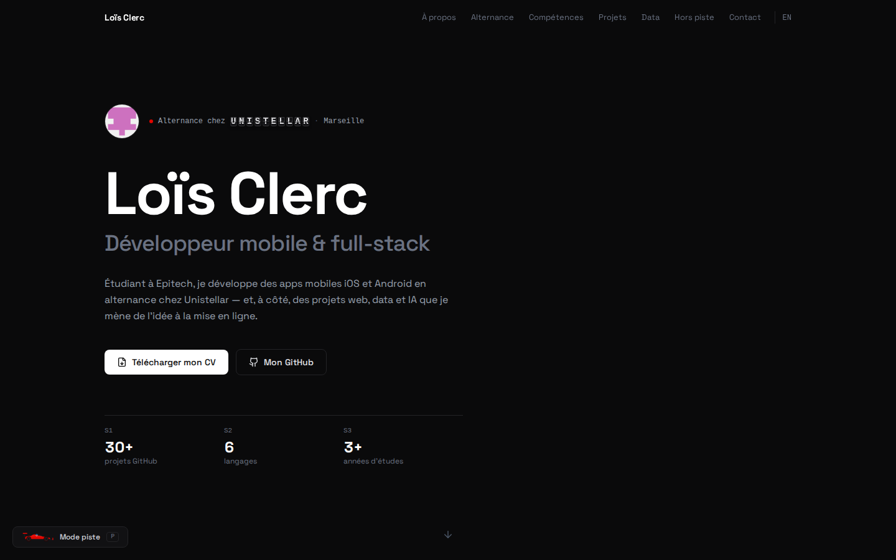

<div align="center">

# Loïs Clerc — Portfolio

Développeur mobile & full-stack · Étudiant à Epitech · Alternant chez Unistellar

**[portfolio-loisclerc.vercel.app](https://portfolio-loisclerc.vercel.app/)** · FR / EN




</div>

## Présentation

Portfolio personnel en une page, sous un ciel profond qui se révèle au fil du scroll — comme
l'empilement de poses d'un télescope Unistellar. Et un vaisseau pilotable au clavier
peut traverser le site.
Les projets et les statistiques sont **calculés en direct depuis GitHub** : rien n'est saisi à
la main, le site se met à jour à chaque nouveau dépôt publié.

## Fonctionnalités

| | |
|---|---|
| **Projets synchronisés** | Dépôts récupérés via l'API GitHub (cache *stale-while-revalidate*), filtres par catégorie et par langage, classement réorganisable par glisser-déposer, fiche détaillée par projet. |
| **Data en direct** | Répartition des langages, part de dépôts actifs, avec démo en ligne et documentés — tout est recalculé à chaque visite. |
| **Ciel profond** | Fond animé sur canvas : étoiles en parallaxe, Voie lactée, nébuleuse et galaxie générées en bruit fractal qui se révèlent avec le scroll, Saturne, satellites et étoiles filantes. Image fixe si l'utilisateur réduit les animations. |
| **Mode vol** | Touche `V` : un vaisseau vu de dessus vole par-dessus la page (inertie, poussée, rétrofusées, bouclier sur les bords, saut en hyperespace, chrono jusqu'au bas de page). Chargé à la demande, il ne pèse rien au premier affichage. |
| **Bilingue** | Français / anglais, choix mémorisé ; i18n maison sans dépendance. |
| **Contact** | Formulaire envoyé via FormSubmit, modèles de message selon le profil (recruteur, développeur…), vCard et QR code téléchargeables. |
| **Commentaires** | Livre d'or adossé aux GitHub Discussions du dépôt via giscus. |
| **Top 4 Letterboxd** | Affiches cliquables dans la section « Hors piste », éditables en local (`?edit=films`) puis exportables. |

## Stack technique

| Domaine | Outils |
|---|---|
| Framework | React 18, Vite 6 |
| Style | Tailwind CSS 4 (tokens dans `src/index.css`), Space Grotesk auto-hébergée |
| Animation | Framer Motion, GSAP (ScrollTrigger) |
| Composants | Sélection de [React Bits](https://reactbits.dev), adaptés au projet (voir ci-dessous) |
| Icônes | Lucide, Simple Icons (`react-icons`) |
| Données | API GitHub REST, FormSubmit, giscus |
| Qualité | Lighthouse CI à chaque push (badges ci-dessus) |
| Hébergement | Vercel |

### Composants React Bits

Chacun a un rôle précis plutôt qu'un rôle décoratif. Ils vivent dans `src/components/reactbits/`
et ont été retouchés : passage à `framer-motion`, corrections d'accessibilité (rôles ARIA,
lecteurs d'écran), nettoyage des animations limité au composant, respect de
`prefers-reduced-motion`.

| Composant | Utilisation |
|---|---|
| `SplitFlapText` | Le nom de l'entreprise s'affiche sur un panneau à palettes, façon écran de chrono |
| `Counter` | Chiffres clés et jauges qui roulent comme un afficheur mécanique |
| `ScrollReveal` | Bio révélée mot à mot au fil du scroll |
| `LogoLoop` | Bandeau de la stack technique |
| `TiltedCard` | Affiches du Top 4 qui s'inclinent sous le pointeur |
| `Noise` | Léger grain de pellicule sur les affiches |

## Démarrage

Prérequis : Node.js 20 ou plus récent.

```bash
git clone https://github.com/LaFicelleCmoi/portfolio-fable.git
cd portfolio-fable
npm install
npm run dev
```

| Script | Rôle |
|---|---|
| `npm run dev` | Serveur de développement sur http://localhost:5173 |
| `npm run build` | Build de production dans `dist/` |
| `npm run preview` | Sert le build de production en local |

## Structure

```
src/
├── sections/        Une section de la page par fichier (Hero, About, Experience, Projects…)
├── components/      Composants partagés (Navbar, Card, Button, FlightMode, Spaceship…)
│   └── reactbits/   Composants React Bits adaptés
├── data/            Contenus éditables : Top 4 films, fiches projets
├── hooks/           useGithubRepos — récupération et cache des dépôts
├── utils/           Formatage des dates relatives
├── i18n.jsx         Contexte de langue FR / EN
└── index.css        Thème (couleurs, typographie) et animations globales
public/              CV, vCard, QR code, affiches, page 404
```

## Personnalisation

| Quoi | Où |
|---|---|
| Textes des sections | Objet `STRINGS = { fr, en }` en tête de chaque fichier de `src/sections/` |
| Fiches projets, podium, catégories | `src/data/projectDetails.js` |
| Top 4 films | `src/data/films.json` + affiches dans `public/` |
| Email, LinkedIn | Constantes en tête de `src/sections/Contact.jsx` |
| CV, vCard, QR code | `public/cv-lois.pdf`, `public/lois-clerc.vcf`, `public/qr-portfolio.png` |
| Couleurs | Tokens `@theme` dans `src/index.css` |

## Déploiement et qualité

- **Vercel** : chaque push sur `main` déclenche un déploiement de production.
- **Lighthouse CI** ([`.github/workflows/lighthouse.yml`](.github/workflows/lighthouse.yml)) :
  build, audit mobile, puis mise à jour automatique des badges de score.
- **Accessibilité** : HTML sémantique, navigation clavier, focus visibles, libellés ARIA,
  animations coupées si l'utilisateur le demande au système.

## Contact

[LinkedIn](https://www.linkedin.com/in/lo%C3%AFs-clerc-a46583386/) ·
[GitHub](https://github.com/LaFicelleCmoi) ·
[lois.clerc@epitech.eu](mailto:lois.clerc@epitech.eu)
